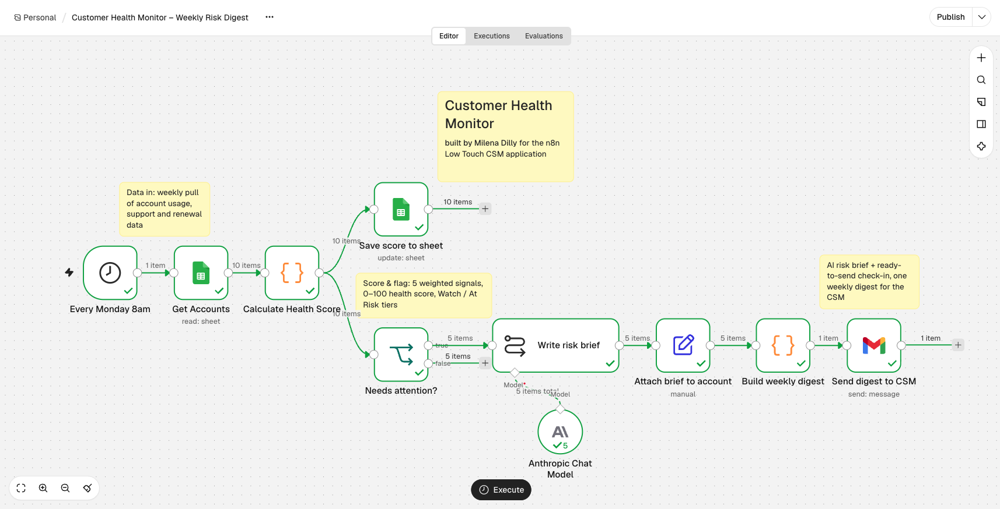
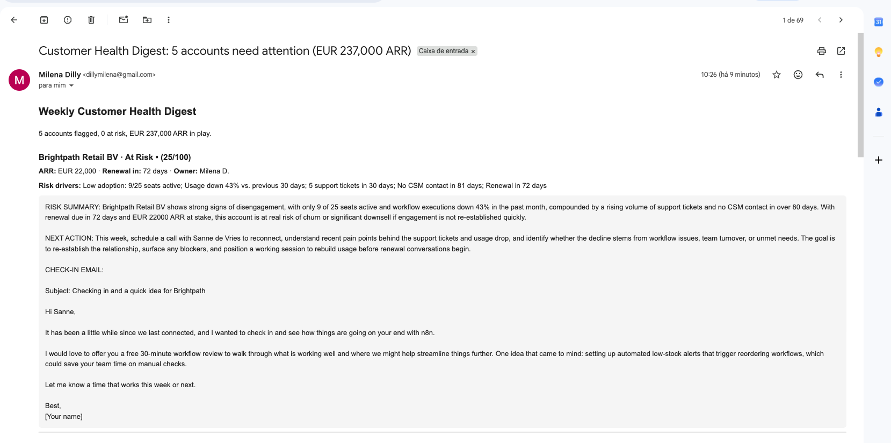

# Customer Health Monitor — Weekly Risk Digest (n8n)

An n8n workflow that does the operational core of a Customer Success Manager's week: every Monday at 8am (Europe/Berlin) it scores each account's health, flags the ones that need attention, asks an LLM for a risk brief, and emails the CSM a single digest with ready-to-send check-in emails.

Built by **Milena D.** as part of my application for the **Low-touch Customer Success Manager (EMEA)** role at n8n.

## What it does

| Step | Node | What happens |
| --- | --- | --- |
| 1 | Schedule Trigger | Runs every Monday at 8am, Berlin time |
| 2 | Google Sheets | Pulls account data: seats, active users, executions, tickets, last contact, renewal date |
| 3 | Code | Calculates a 0–100 health score and lists the risk drivers |
| 4 | Google Sheets | Writes the score, tier and drivers back to the sheet |
| 5 | IF | Sends only **Watch** and **At Risk** accounts forward |
| 6 | Basic LLM Chain + Anthropic | Writes a risk summary, a next action and a check-in email per account |
| 7 | Edit Fields | Joins the AI brief back to the account data |
| 8 | Code | Builds one HTML digest, riskiest accounts first, with total ARR in play |
| 9 | Gmail | Emails the digest to the CSM |

## How the health score works

Five weighted signals, each mapped to what a CSM would actually act on:

| Signal | Weight | Why it matters |
| --- | --- | --- |
| Seat adoption (active users / seats purchased) | 35 | Unused seats are the earliest sign of a contraction at renewal |
| Usage trend (executions vs. previous 30 days) | 25 | A falling trend shows value slipping before the customer says so |
| Support load (tickets in 30 days) | 15 | Friction that, unresolved, turns into churn |
| Engagement recency (days since last CSM contact) | 15 | Silence on a large account is a risk on its own |
| Renewal proximity | 10 | The same risk is more urgent 60 days before renewal than 9 months before |

**Tiers:** Healthy ≥ 70 · Watch 45–69 · At Risk < 45.

On the sample data the workflow flags 5 of 10 accounts — 3 At Risk, 2 Watch — with **EUR 237,000 ARR** in play.

## Run it yourself

1. Import `sample-data/customer-health-data.csv` into a Google Sheet (File → Import, separator: comma, **uncheck** "convert text to numbers, dates and formulas") and name the tab `Accounts`.
2. In n8n, go to **Workflows → Import from File** and select `workflow.json`.
3. Connect your Google Sheets, Gmail and AI model credentials.
4. In both Google Sheets nodes, select your sheet; in the Gmail node, set your email address.
5. Click **Execute workflow**.

## What I would add with real data

- Replace the sheet with live product telemetry (executions, active users) and CRM data (renewal dates, last touchpoint).
- Log each week's score to track health over time and alert on sharp drops, not just low levels.
- Route At Risk accounts to a Slack channel with an owner and a due date, turning the digest into a playbook for the whole CS team.
